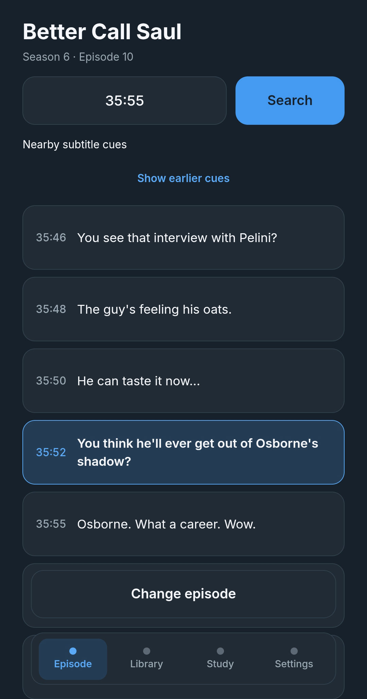
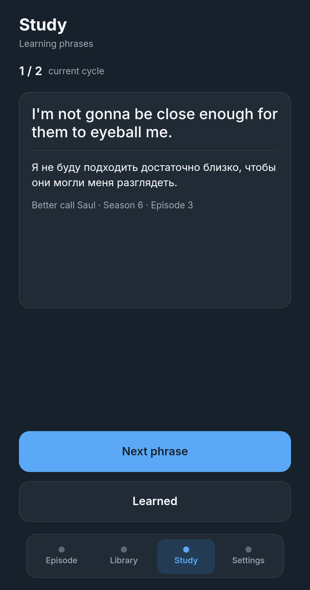
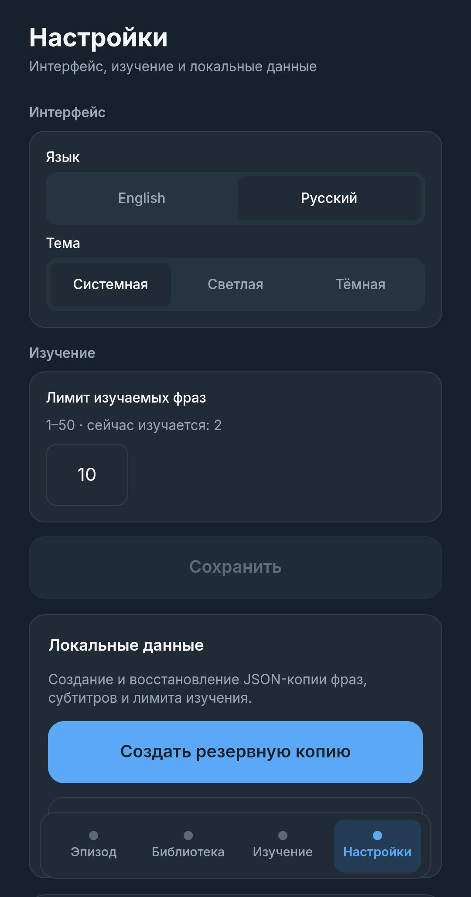

# PhraseCue

A small web app I built to save and learn English phrases from TV series.

I'm learning English and often watch shows with English subtitles. Sometimes I want to find a particular line, check its Russian translation and remember it for later. That's how the idea for PhraseCue came about.

The app lets me find subtitle lines by approximate timecode or text search, save phrases and return to them when studying.

**[Live demo](https://alexeydev42.com/phrase-cue/)**

## Screenshots

<p align="center">
  <a href="docs/screenshots/episode-mobile.jpg">
    
  </a>
  <a href="docs/screenshots/study-mobile.jpg">
    
  </a>
  <a href="docs/screenshots/settings-mobile.jpg">
    
  </a>
</p>

## Features

- Import English subtitles from `.srt` files.
- Organize subtitles by show, season and episode.
- Find subtitle lines using an approximate timecode or text search.
- Combine nearby lines and edit the text before saving.
- Translate phrases into Russian or save them without translation.
- Organize saved phrases into New, Learning and Learned.
- Review phrases in random order, revealing translations when needed.
- Switch between English and Russian interfaces and Light/Dark themes.
- Export and restore data using JSON backups.

## How it works

I usually use PhraseCue while watching an episode. I pause the video and switch to the app. I can enter an approximate timecode to see nearby subtitle lines, or search by a word or phrase to find matching lines in the current episode.

Before saving, I can adjust the text and request a translation.

Saved phrases go into the Library. When I'm ready to study them, I move them to Learning and review them as cards with hidden translations.

## Technical decisions

I built PhraseCue with React, TypeScript and Redux Toolkit. One of my goals was to get more practice with Redux, especially state management, selectors and asynchronous operations.

The app stores shows, subtitles, saved phrases and the Learning limit in IndexedDB. Interface preferences and the active episode are kept in localStorage.

There are no user accounts or automatic synchronization between devices. JSON backups can be used to move data between them.

Translation works through a serverless API rather than directly from the browser. The primary endpoint runs on Yandex Cloud Functions, uses Google Cloud Translation and has YDB-based rate limiting. A Vercel endpoint is available as a fallback for server or network failures.

The interface is mobile-first because I mainly wanted to use the app on my phone while watching shows.

## Tech stack

- React 19, TypeScript
- Redux Toolkit, React Redux
- React Router
- Vite
- CSS Modules
- IndexedDB (`idb`)
- Yandex Cloud Functions, YDB, Vercel
- Google Cloud Translation API
- Vitest, React Testing Library
- ESLint, Stylelint, Prettier
- GitHub Actions, GitHub Pages

## Run locally

Node.js 24 and npm are required.

```bash
git clone https://github.com/alexeydev42/phrase-cue.git
cd phrase-cue
npm ci
npm run dev
```

To enable translation, create a `.env.local` file with the serverless endpoint URLs:

```env
VITE_TRANSLATION_API_URL=https://your-primary-endpoint
VITE_TRANSLATION_FALLBACK_API_URL=https://your-fallback-endpoint
```

Translation requires an internet connection. The application can still be used to collect and study phrases without it.

Useful commands:

```bash
npm run lint
npm run test
npm run build
```

## Data storage

PhraseCue keeps saved phrases and imported subtitles in the browser. Translation requests send the selected English text to the configured translation service.

A JSON backup contains saved phrases, shows with imported subtitles and the Learning limit. Restoring a backup replaces the existing backed-up data rather than merging it.

Clearing the browser's site data may remove locally stored phrases and subtitles, so it's worth keeping a backup.
